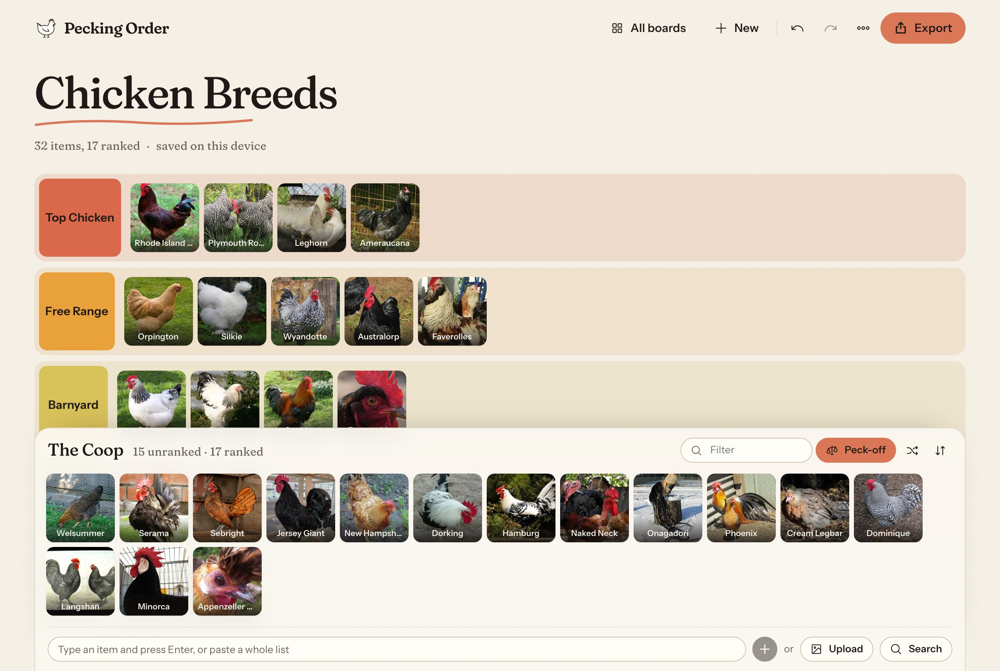
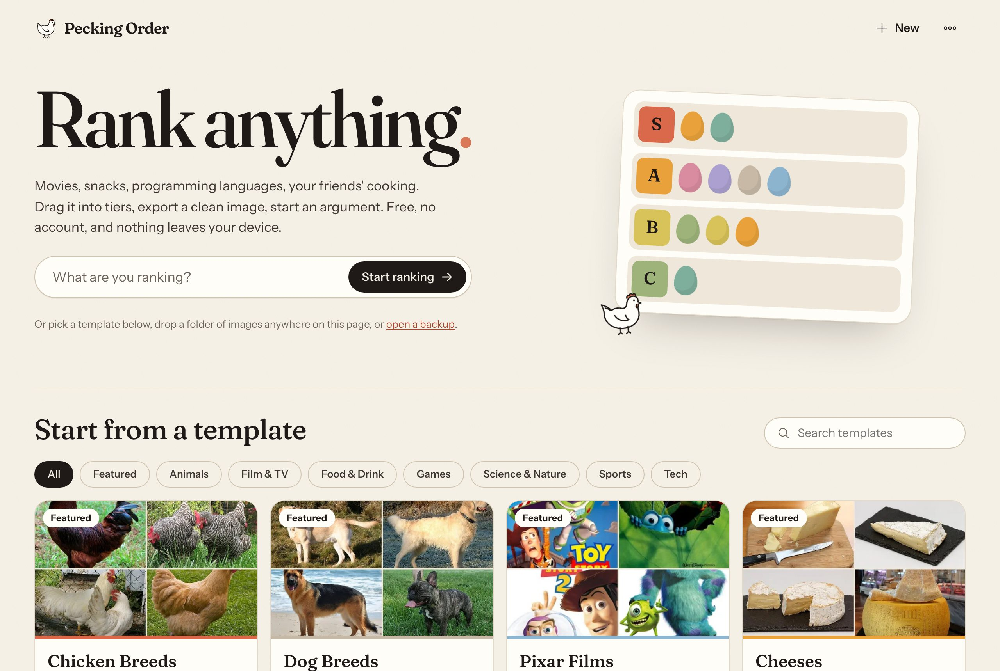
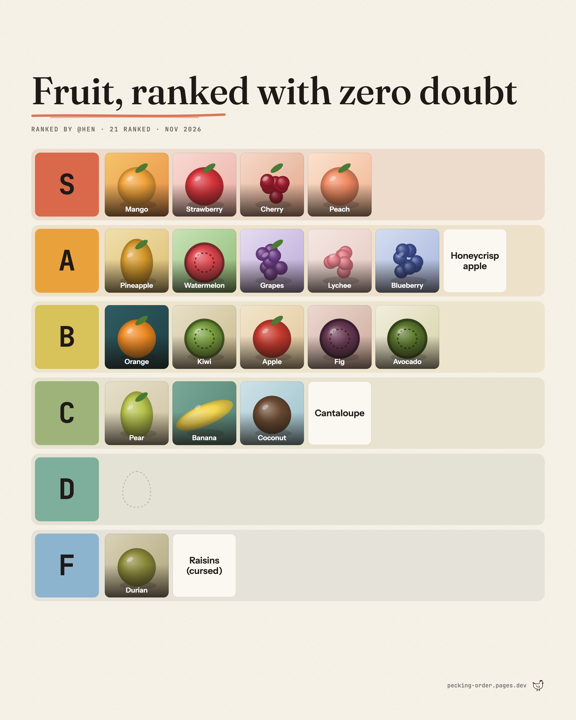
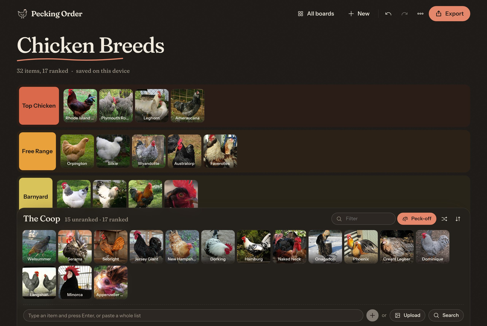
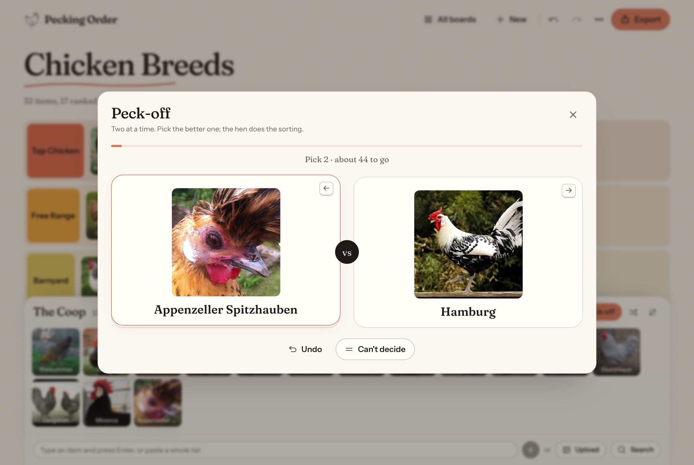
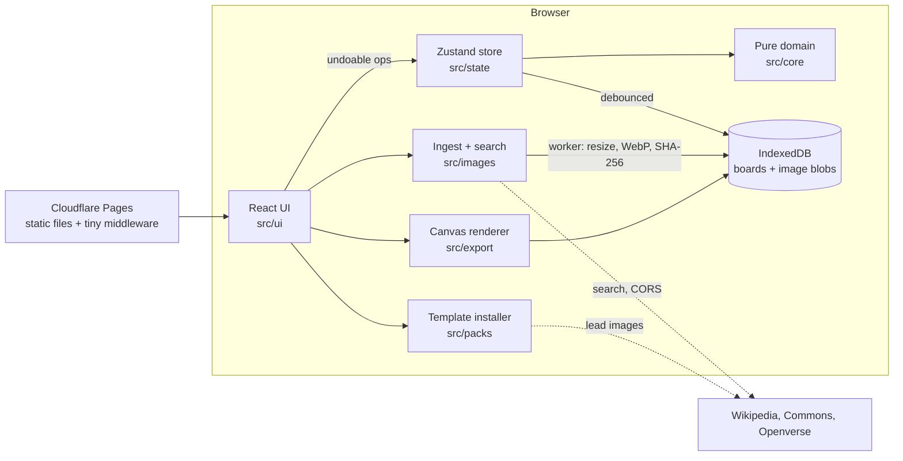

<div align="center">


# Pecking Order

**Rank anything.** Movies, snacks, programming languages, your friends' cooking.<br />
Drag it into tiers, export a clean image, start an argument.

[**Open the app →**](https://pecking-order.pages.dev) &nbsp;·&nbsp; [Add a template](CONTRIBUTING-PACKS.md) &nbsp;·&nbsp; [How it works](docs/ARCHITECTURE.md)

[](https://github.com/KarthikSubramanian07/Pecking-Order/actions/workflows/ci.yml)
[](LICENSE)


[](https://buymeacoffee.com/winnerkarthik)



</div>

## Why another tier list maker?

Because the popular ones want an account, show you ads, upload your photos to
someone else's server, and lose your work when you close the tab. Pecking Order
runs entirely in your browser. There is no backend, no sign up, no tracking and no
upload. Your boards and pictures live in your browser's storage until you export
them, and the whole thing is MIT licensed so you can see exactly that.

It is also, unapologetically, about chickens. Unranked items wait in **the Coop**.
Exports are **laid**. When nothing is ranked yet, _every list starts as an egg_.
The hen stays out of your way otherwise.

## What it does

|                              |                                                                                                                                                                                                             |
| ---------------------------- | ----------------------------------------------------------------------------------------------------------------------------------------------------------------------------------------------------------- |
| **Drag that feels physical** | Tiles lean into your motion, lift off the board and land with a little peck. Tiers wrap onto as many lines as they need and drops still land where you point.                                               |
| **Pictures without effort**  | Upload files, drop a whole folder, paste from the clipboard, drag images in from another tab, or search Wikipedia, Wikimedia Commons and Openverse right inside the app. Credits travel with every picture. |
| **Templates**                | Start from a ready-made pack (chicken breeds, cheeses, Pixar films, programming languages and more) and the Coop fills itself, pictures included. Anyone can add one with a single JSON file.               |
| **Peck-off**                 | Can't decide? Answer quick head-to-heads and a binary insertion sort ranks everything in about n·log₂n picks, then spreads the result across your tiers.                                                    |
| **Clean, shareable exports** | A crisp PNG drawn on your device in four sizes (wide, Instagram portrait, story, or fit to content) and two themes. Download, copy or share.                                                                |
| **Yours, locally**           | Autosave, undo and redo for every change, any number of boards, and `.peck` backup files that carry a board and its pictures to another device.                                                             |
| **Everyone can use it**      | Full keyboard control, screen reader announcements for every move, tap-to-place on touch screens, light and dark themes, and reduced motion.                                                                |

<table>
<tr>
<td width="50%"></td>
<td width="50%"></td>
</tr>
<tr>
<td width="50%"></td>
<td width="50%"></td>
</tr>
</table>

## Keyboard

| Key                                                            | Does                                    |
| -------------------------------------------------------------- | --------------------------------------- |
| <kbd>Space</kbd> then arrows, <kbd>Space</kbd>                 | Pick up, move and drop the focused item |
| <kbd>1</kbd> to <kbd>9</kbd>                                   | Send the focused item to that tier      |
| <kbd>0</kbd>                                                   | Send it back to the Coop                |
| <kbd>E</kbd> / <kbd>Delete</kbd>                               | Edit / remove the focused item          |
| <kbd>⌘</kbd><kbd>Z</kbd>, <kbd>⌘</kbd><kbd>⇧</kbd><kbd>Z</kbd> | Undo, redo                              |
| <kbd>⌘</kbd><kbd>V</kbd>                                       | Paste images, links or a whole list     |
| <kbd>?</kbd>                                                   | Every shortcut                          |

## Run it locally

```sh
git clone https://github.com/KarthikSubramanian07/Pecking-Order.git
cd Pecking-Order
npm ci
npm run dev        # http://localhost:5173
```

Node 22.12 or newer (the repo pins 24 in `.nvmrc`). That's all: no database, no
environment variables, no API keys.

| Script                               | What it does                                               |
| ------------------------------------ | ---------------------------------------------------------- |
| `npm run dev`                        | Start Vite with hot reload (builds the packs first)        |
| `npm test`                           | Unit and component tests (Vitest)                          |
| `npm run e2e`                        | End-to-end and accessibility tests (Playwright + axe)      |
| `npm run lint` / `npm run typecheck` | Biome and the TypeScript 7 compiler                        |
| `npm run build`                      | Production build into `dist/`                              |
| `npm run packs:validate`             | Check every template against the pack rules                |
| `npm run packs:covers -- <id>`       | Render a template's home page cover                        |
| `npm run icons`                      | Regenerate the slim icon module after importing a new icon |

## How it's built



- **No backend.** Static files on Cloudflare Pages, plus one small middleware that
  serves Markdown to agents that ask for it and the app shell for board URLs.
- **`src/core` is pure TypeScript.** Tiers, items, placement, Peck-off and input
  validation have no React and no DOM, so they're trivial to test.
- **Images are content-addressed.** Every picture is resized off the main thread,
  hashed, and stored once in IndexedDB no matter how many boards use it. That is
  also why exports can never be tainted by cross-origin images.
- **Exports are drawn, not screenshotted.** A hand-written Canvas 2D renderer lays
  out the board from data, which keeps PNGs sharp on every browser.

The full tour, with the reasoning behind each choice, is in
[docs/ARCHITECTURE.md](docs/ARCHITECTURE.md).

## Project layout

```text
src/
  core/       pure domain: board ops, Peck-off, validation, palette, undo history
  state/      Zustand stores (board + UI preferences)
  storage/    IndexedDB access and .peck backup files
  images/     ingest (files, folders, paste, URLs), worker processing, search sources
  packs/      template catalog, image resolver and installer
  export/     canvas layout and renderer, download/copy/share
  agent/      WebMCP tools for in-browser AI agents
  ui/         React components: home, board, dialogs, primitives
packs/        one folder per template (pack.json + cover.webp)
functions/    Cloudflare Pages middleware
public/       static pages, llms.txt, security headers, icons
e2e/          Playwright tests
scripts/      pack build/validation, covers, icons, brand assets
```

## Contributing

The easiest way in is a template: pick a topic people love to argue about, write
one `pack.json`, and the guide in [CONTRIBUTING-PACKS.md](CONTRIBUTING-PACKS.md)
walks you through images, validation and covers. For code changes, see
[CONTRIBUTING.md](CONTRIBUTING.md). Good first issues are labelled on GitHub.

Please be kind: [Code of Conduct](CODE_OF_CONDUCT.md). Found a security problem?
See [SECURITY.md](SECURITY.md) and report it privately.

## Privacy

There are no cookies, no analytics and no accounts. The only requests your
browser makes beyond this site are the ones you ask for: image searches go to
Wikipedia, Wikimedia Commons or Openverse, and installing a template downloads its
pictures from Wikimedia. Details on the [privacy page](https://pecking-order.pages.dev/privacy/).

## Support

If Pecking Order settled an argument for you, you can
[buy me a coffee](https://buymeacoffee.com/winnerkarthik). Stars and new templates
are just as welcome.

## License

[MIT](LICENSE) © 2026 Karthik Subramanian. Template pictures belong to their
authors and keep their original licences, which the app shows on every item.
